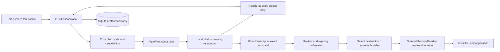

# Architecture and end-to-end workflow

Wayland Voice Control is a local desktop application. It has no web backend,
account service, cloud recognition, transcript database or command-generating LLM.
The native UI, policy engine and operating-system adapters run in one Python
application, with speech and input work moved off the GTK thread.

## Module boundaries

| Layer | Responsibility | Must not do |
| --- | --- | --- |
| `domain.py`, `commands.py` | Exact grammar, immutable action IDs, validation, expiry, confirmation and consumption | Read devices, send input, persist content |
| `storage.py`, `schema.sql` | Validate and atomically persist preferences | Store recordings, transcripts, action history or permission tokens |
| `audio.py` | Prepare/cache local models without microphone access; own one bounded capture worker/recorder and coalesced draft mailbox | Download models, record when not held, expose private dependency errors |
| `speech.py` | Decode bounded streaming partials and completed segments for both capture and offline benchmarks | Convert provisional text into final review content |
| `speech_benchmark.py` | Measure local WAV decode timings through the shared decoder | Open a microphone, print transcripts, copy audio or use the network |
| `transport.py`, `gio_transport.py` | Correlate asynchronous D-Bus requests and responses; dispatch onto GLib | Infer consent from capability availability |
| `portal.py` | Keyboard-only RemoteDesktop and explicit GlobalShortcuts sessions | Use privileged input helpers or silently regain permission |
| `controller.py` | Join adapters to the policy, cancel stale callbacks, publish immutable snapshots | Treat a draft or stale callback as approval |
| Native views | Render real state and invoke explicit user actions | Invent readiness, silently confirm or execute text |

See [adapter-api.md](adapter-api.md) for the exact integration contract and
[schema.md](schema.md) for persistent and transient data structures.

## Startup and setup

Launch starts with no microphone capture and no portal dialog. Load the local
preferences; display missing dependencies and model configuration. The user
chooses an extracted local Vosk model, explicitly enables application microphone
consent and explicitly requests desktop keyboard permission. Global shortcut
binding is a separate optional consent step. Neither a saved preference nor
successful portal introspection is an operating-system keyboard grant.

Model preparation runs locally without opening the microphone. It lets the user
wait for cold model loading before holding the talk control. The app displays a
draft during speech, then offers finalized text for review after release. Drafts
can change and have no authority to execute anything.

## State and approval

```mermaid
stateDiagram-v2
    [*] --> Idle
    Idle --> Recording: hold + permission + mic consent
    Recording --> Processing: release or duration cap
    Processing --> Reviewing: finalized valid transcript
    Reviewing --> Reviewing: edit creates a new action ID
    Reviewing --> Armed: confirm ordinary action
    Reviewing --> SecondConfirmation: confirm risky command
    SecondConfirmation --> Armed: distinct second confirmation
    Armed --> Executing: delay ends + recheck gates and expiry
    Executing --> Idle: completed once
    Processing --> Error: recognition / validation failure
    Executing --> Error: input failure; never auto retry
    Error --> Idle: explicit reset
```

Cancel is available throughout and discards pending work. Stop also closes the
keyboard and shortcut sessions. Permission revocation cancels pending work.
Editing invalidates prior confirmation even when the new text is invalid; an
event with an old action ID cannot cancel or overwrite newer work. Expiry is
checked when approval is used, including immediately before execution.

Ordinary confirmation is required for every insertion or command. Press Enter,
close window and delete selection require a second, distinct local confirmation.
The global confirm shortcut cannot satisfy that second stage. Dictation is
literal text; line breaks, tabs and other control/formatting characters are
rejected. The command parser accepts one exact allowlisted phrase, with case and
whitespace normalization only.

## Threads, cancellation and permissions

All controller calls and observers belong on the GTK/GLib thread. Workers publish
through the dispatcher. Each action has a generation so queued results from
canceled recordings, edited actions or stopped input are ignored. Permission
requests have separate attempt identities: normal cancellation closes an
unfinished request but can preserve an already completed keyboard grant.
Emergency stop closes both unfinished and completed sessions.

Portal response handlers are installed before method calls, and early responses
are buffered until the returned request path is verified. Only an actual granted
keyboard bit enables input. Key delivery releases pressed keys on failure or
cancellation; partial delivery is reported without automatic replay.

The portal cannot identify the intended field or guarantee an application's
interpretation of a key. The user selects the destination during a visible delay
or confirms globally while already focused there. See
[privacy.md](privacy.md) for the complete trust boundary.

## Practice and release boundaries

Practice uses a separate coordinator and an in-memory input adapter. Typed
examples exercise review, edits, expiry and confirmation without opening the
microphone or desktop sessions. Its output is explicitly a local preview.

Unit and private D-Bus tests verify policy and protocol behavior. Xvfb verifies
native widgets. Neither establishes real GNOME input compatibility or speech
usability. [manual-test.md](manual-test.md) defines those release gates;
[validation.md](validation.md) records what was actually run.
